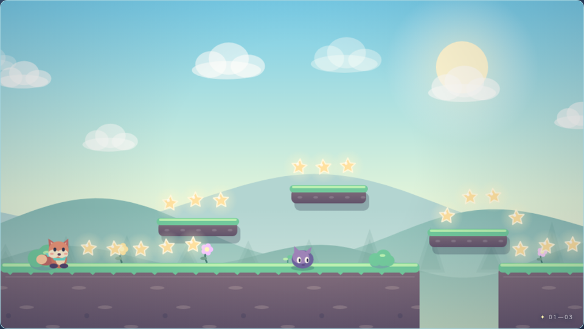

# ✦ Luma Hop

A little original 2D platform adventure to share with your friends. Guide Pip the fox through **three colorful side-scrolling worlds**, collect magical stars, jump over gaps, bounce on friendly-looking-but-troublesome grumplings, and find the glowing door.

**Runs in any modern browser.** No framework, build tools, server code, copyrighted character sprites, or external assets are required.

## Play

Open `index.html` in your browser, or visit your published GitHub Pages URL.

| Action | Keyboard | Phone / tablet |
| --- | --- | --- |
| Move | `←` / `→` or `A` / `D` | On-screen left / right buttons |
| Jump | `Space`, `↑`, `W`, or `K` | On-screen Jump button |
| Pause / resume | `Esc` or `P` | Pause button in the header |
| Restart adventure | `R` | Restart from pause / end screen |
| Toggle sound | `M` | Speaker button |
| Fullscreen | Fullscreen button | Fullscreen button (if supported) |

Jump on a grumpling's head to defeat it. Running into one or falling into a gap costs one heart. You have three hearts per world (refilled when you reach the next world), and each level has a checkpoint. Your best score and fastest completed run are stored locally on **your own device**.

## Publish on GitHub Pages (no coding needed)

1. **Extract** the ZIP file. It includes `index.html`, `style.css`, `game.js`, `favicon.svg`, this `README.md`, a `preview.png` screenshot, and `LICENSE`.
2. Sign in to [GitHub](https://github.com/) and create a **public repository**, e.g. `luma-hop`.
3. Upload all the extracted files **directly into the repository root** (not inside a nested `luma-hop` folder). Commit the files.
4. In your repository, open **Settings → Pages**.
5. Under **Build and deployment**, choose **Deploy from a branch**, select **`main`** and **`/(root)`**, then click **Save**.
6. Once GitHub Pages finishes deploying, share `https://YOUR-USERNAME.github.io/luma-hop/` with your friends. For a repository named `YOUR-USERNAME.github.io`, the site address is simply `https://YOUR-USERNAME.github.io/`.

> Tip: In GitHub's **Add file → Upload files**, select the *extracted files*, not the ZIP itself. GitHub Pages needs `index.html` at the selected publication root.

## Customize your game

- **Name, instructions, buttons:** `index.html`
- **Colors, menus, layout, touch controls:** `style.css`
- **Worlds, platform positions, difficulty, stars, enemies, player physics, artwork and sound:** `game.js`
- The `LEVELS` array near the top of `game.js` contains all three world layouts. Each `[x, end]` ground tuple describes a solid ground stretch; platform tuples are `[x, y, width]`; enemy tuples are `[x, patrolLeft, patrolRight, speed]`.
- The entire game uses original procedural drawings with the HTML Canvas API, plus small Web Audio sound effects. It needs **no internet** after loading.

## License

Code and original graphics in this mini-game are released under the MIT License. See `LICENSE`.

Have fun, and may your jumps be well-timed! ✨
